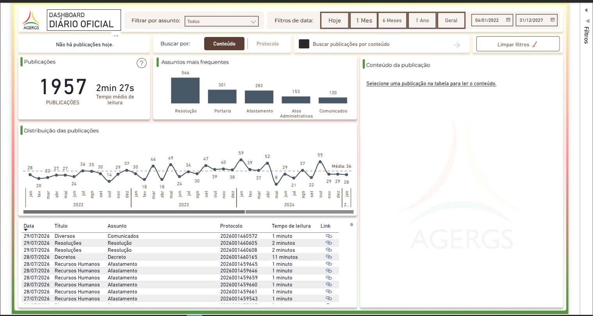
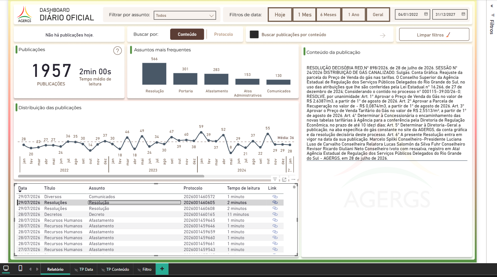
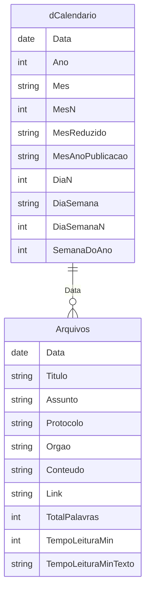
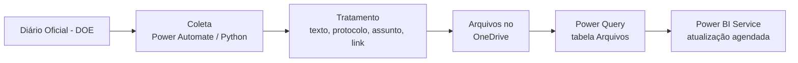

# 📰 Dashboard Diário Oficial — AGERGS

Painel em **Power BI** desenvolvido na **AGERGS** (Agência Estadual de Regulação dos Serviços Públicos Delegados do Rio Grande do Sul) para centralizar, pesquisar e analisar as publicações da agência no **Diário Oficial do Estado (DOE)**.

O objetivo é dar às equipes uma forma rápida de saber **o que foi publicado, quando, sobre qual assunto**, e ler o conteúdo completo de cada publicação sem precisar navegar pelo site do Diário Oficial.

---
> ⚠️ **Os dados apresentados neste projeto são de domínio público e foram utilizados neste portfólio com autorização da AGERGS.**
## 📌 Sumário

- [Contexto e problema](#-contexto-e-problema)
- [Visão geral do dashboard](#-visão-geral-do-dashboard)
- [Funcionalidades](#-funcionalidades)
- [Modelo de dados](#-modelo-de-dados)
- [Colunas calculadas](#-colunas-calculadas)
- [Medidas DAX](#-medidas-dax)
- [Fonte e atualização dos dados](#-fonte-e-atualização-dos-dados)
- [Tecnologias](#-tecnologias)
- [Aprendizados](#-aprendizados)

---

## 🎯 Contexto e problema

As publicações da AGERGS no Diário Oficial (resoluções, portarias, afastamentos, atos administrativos, comunicados, decretos etc.) ficavam espalhadas em várias edições do DOE. Para encontrar uma publicação específica, era preciso buscar manualmente por data ou protocolo, e não havia uma visão consolidada do volume publicado nem dos assuntos mais recorrentes.

O dashboard resolve isso com:
- **um único lugar** para consultar todas as publicações desde 2022;
- **busca por conteúdo ou por protocolo**;
- **leitura do texto completo** dentro do próprio painel;
- **indicadores** de volume, frequência por assunto e tendência ao longo do tempo.

---

## 📊 Visão geral do dashboard

O layout segue a identidade visual da AGERGS e é dividido em quatro áreas:

| Área | Descrição |
|---|---|
| **Cabeçalho / filtros** | Filtro por assunto, botões de período rápido e intervalo de datas personalizado |
| **Busca** | Alternância entre busca por *Conteúdo* ou *Protocolo*, campo de pesquisa e botão *Limpar filtros* |
| **Indicadores e gráficos** | Total de publicações, tempo médio de leitura, assuntos mais frequentes e distribuição mensal |
| **Tabela + leitor** | Lista de publicações com link para o DOE e painel lateral que exibe o conteúdo completo da publicação selecionada |

---

## 🧩 Funcionalidades

### Filtros

| Filtro | O que faz |
|---|---|
| Filtrar por assunto | Lista suspensa com todos os assuntos (Resolução, Portaria, Afastamento, Atos Administrativos, Comunicados, Decreto...) |
| Filtros rápidos de data | Botões `Hoje`, `1 Mês`, `6 Meses`, `1 Ano` e `Geral` |
| Intervalo personalizado | Seleção de data inicial e data final |
| Limpar filtros | Volta o painel ao estado padrão com um clique |

### Busca

| Modo | O que faz |
|---|---|
| Por conteúdo | Pesquisa termos dentro do texto integral das publicações |
| Por protocolo | Localiza diretamente uma publicação pelo número de protocolo |

### Indicadores

| Visual | O que mostra |
|---|---|
| Card de hoje | Quantidade de publicações do dia, ou a mensagem *"Não há publicações hoje."* |
| Publicações | Total de publicações no período filtrado |
| Tempo médio de leitura | Média estimada a partir da quantidade de palavras (ex.: `2min 27s`) |
| Assuntos mais frequentes | Gráfico de barras com o top 5 de assuntos |
| Distribuição das publicações | Gráfico de linha mensal com hierarquia mês/ano e linha de média de referência |

### Tabela e leitor de publicações

- Colunas: **Data, Título, Assunto, Protocolo, Tempo de leitura, Link**.
- O ícone de **Link** abre a publicação original no Diário Oficial.
- Ao **selecionar uma linha**, o painel *Conteúdo da publicação* mostra o texto integral.
- Sem seleção, o painel exibe a orientação *"Selecione uma publicação na tabela para ler o conteúdo."*

---

## 🧱 Modelo de dados

Modelo **estrela** simples, com uma tabela fato, uma dimensão de calendário e uma tabela dedicada só para as medidas.

> A tabela `Medidas` não tem relacionamentos. Ela serve só para organizar as medidas DAX.

### `Arquivos` (fato)

| Coluna | Descrição |
|---|---|
| `Data` | Data de publicação no DOE |
| `Título` | Seção/título da publicação (ex.: Resoluções, Recursos Humanos, Decretos) |
| `Assunto` | Classificação da publicação (Resolução, Portaria, Afastamento...) |
| `Protocolo` | Número de protocolo da publicação |
| `Órgão` | Órgão responsável |
| `Conteúdo` | Texto integral da publicação |
| `Link` | URL da publicação original (categoria de dados: URL da Web) |
| `Total palavras` | Coluna calculada: contagem de palavras do conteúdo |
| `TempoLeituraMin` | Coluna calculada: tempo estimado de leitura em minutos |
| `TempoLeituraMinTexto` | Coluna calculada: tempo formatado para exibição (ex.: "2 minutos") |

### `dCalendário` (dimensão)

| Coluna | Descrição |
|---|---|
| `Data` | Data (chave do relacionamento) |
| `Ano`, `Mês`, `Mês N`, `Mês reduzido` | Atributos de ano e mês |
| `Mês e Ano publicação` | Rótulo usado no eixo do gráfico de distribuição |
| `Dia N`, `Dia semana`, `Dia semana N` | Atributos de dia |
| `Semana do ano` | Número da semana |

**Relacionamento:** `dCalendário[Data]` 1 → * `Arquivos[Data]`, com filtragem em direção única.

---

## 🧮 Colunas calculadas

| Coluna | Lógica |
|---|---|
| `Total palavras` | Conta as palavras de `Conteúdo` |
| `TempoLeituraMin` | `Total palavras` ÷ velocidade média de leitura, arredondado |
| `TempoLeituraMinTexto` | Converte o valor em texto amigável ("1 minuto", "11 minutos") |
| `Mês e Ano publicação` | Rótulo mês/ano usado no eixo do gráfico de distribuição |

---

## 📐 Medidas DAX

| Grupo | Medidas | Uso |
|---|---|---|
| Contagem geral | `Qtde publicações` | KPI principal |
| Períodos rápidos | `Qtde publicações hoje`, `Publicações 30 dias`, `Publicações 6 meses`, `Publicações 1 ano`, `Qtde publicações semana` | Botões de filtro rápido e cards |
| Comparativos de tempo | `Qtde publicações LD`, `Qtde Publicações LM`, `Qtde Publicações LY`, `Qtde publicações mês atual`, `Qtde publicações mês anterior`, `Qtde publicações mês selecionado`, `Qtde publicações último dia com publicação` | Comparação com dia, mês e ano anteriores |
| Rótulos dinâmicos | `Ano anterior (nome)`, `Mês anterior (nome)`, `Data Inicial`, `Data Final`, `Sumário Dinâmico` | Textos e títulos que mudam conforme o filtro |
| Leitura | `Média tempo leitura`, `Tempo leitura hoje` | Card de tempo médio (formato `Xmin YYs`) |
| Médias | `Média diária publicações – últimos dias` | Linha de referência e indicadores de média |
| Visual / UX | `Mural publicação`, `Cor variação dia` | Painel de conteúdo e formatação condicional |

---

## 🔄 Fonte e atualização dos dados

| Etapa | Descrição |
|---|---|
| 1. Coleta | As publicações do DOE são obtidas por uma automação criada por mim no Power Automate Desktop |
| 2. Tratamento | Limpeza do texto e extração de protocolo, assunto, título e link |
| 3. Armazenamento | Arquivos em  OneDrive no formato CSV |
| 4. Carga | O Power Query consolida os arquivos na tabela `Arquivos` |
| 5. Atualização | Atualização agendada no Power BI Service 1 vez ao dia |

---

## 💻 Tecnologias

| Ferramenta | Uso |
|---|---|
| Power BI Desktop / Service | Relatório e publicação |
| Power Query (M) | ETL e consolidação dos arquivos |
| DAX | Medidas, inteligência temporal e rótulos dinâmicos |
| Power Automate / Python | Coleta das publicações |
|  OneDrive | Armazenamento dos arquivos |

---

## 📚 Aprendizados

- Modelagem estrela com **dimensão calendário** dedicada e tabela de medidas separada.
- **Inteligência temporal** em DAX (LD, LM, LY e períodos móveis).
- Experiência de uso com **botões, bookmarks e textos dinâmicos**, para o painel funcionar quase como uma aplicação.
- Exibição de **texto longo** dentro do Power BI, como um leitor de documentos.
- Métrica derivada de texto (**tempo de leitura**) a partir da contagem de palavras.

---

## 👤 Autor

**Antonio Augusto Geraldes Filho**
Estagiário de Dados/TI na AGERGS · Análise e Desenvolvimento de Sistemas, Senac-RS
📍 Porto Alegre, RS

> Os dados exibidos são publicações oficiais e públicas do Diário Oficial do Estado do RS.

- [Voltar ao topo](#-sumario)
