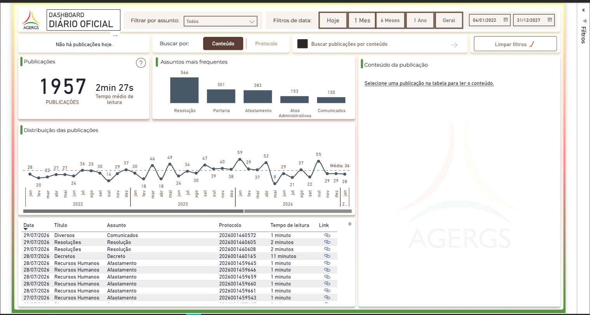
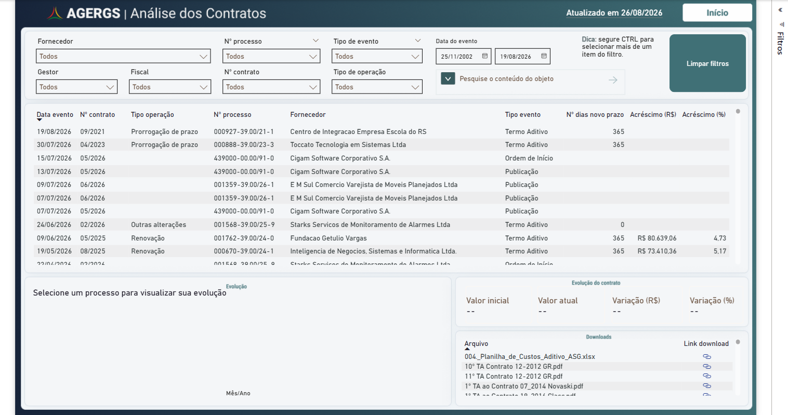
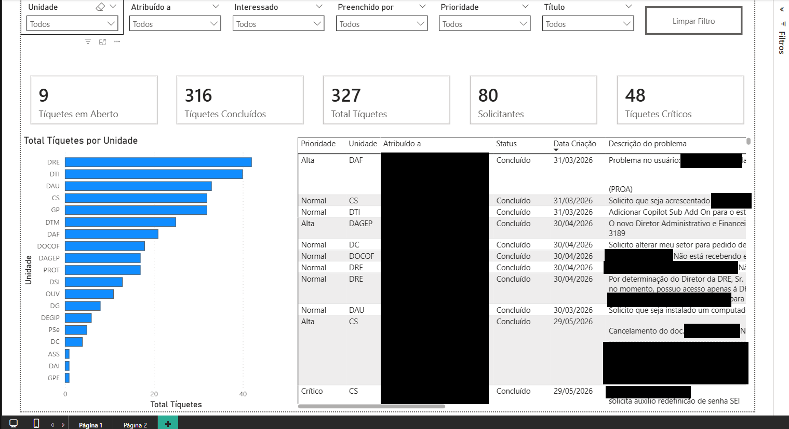
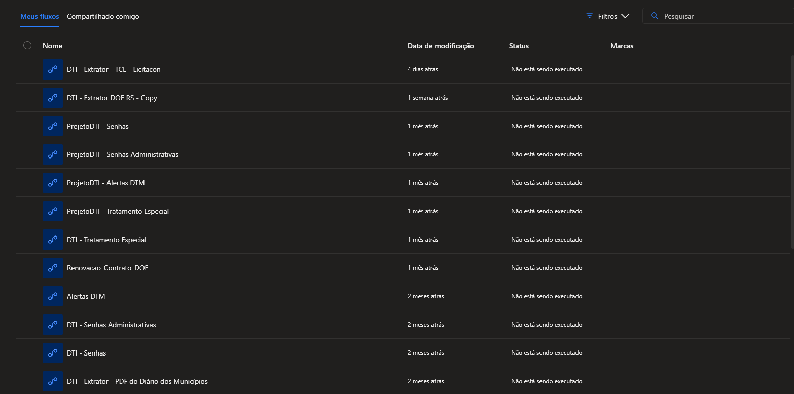
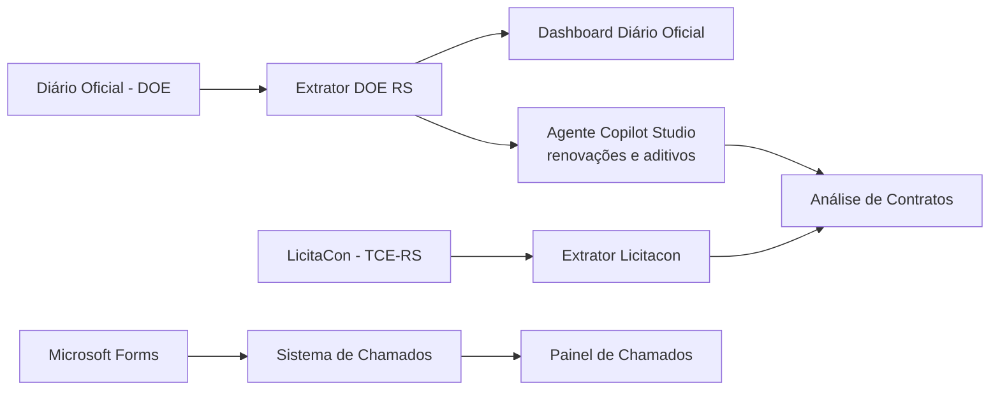

# 📊 Portfólio de Dados e Automações — AGERGS

> ⚠️ **Todos os dados exibidos neste repositório são públicos, e sua divulgação neste portfólio foi devidamente autorizada pela AGERGS.**

Olá! Sou **Antonio Augusto Geraldes Filho**, estagiário de Engenharia de Dados na **AGERGS** (Agência Estadual de Regulação dos Serviços Públicos Delegados do Rio Grande do Sul) e estudante de Análise e Desenvolvimento de Sistemas no Senac-RS.

Este repositório reúne a documentação de projetos que desenvolvi na agência: **dashboards em Power BI**, **automações no Power Automate** e uma **solução de chamados** feita só com ferramentas do Microsoft 365. Cada pasta tem um README próprio com o contexto, a arquitetura, o modelo de dados e imagens da solução.

---

## 🗂️ Projetos

| Projeto | Descrição | Tecnologias |
|---|---|---|
| 📰 [Dashboard Diário Oficial](./Diario_Oficial_do_Estado/Readme_doe_app.md) | Consulta centralizada das publicações da AGERGS no DOE desde 2022, com busca por conteúdo ou protocolo, leitura do texto completo e indicadores | Power BI · DAX · Power Query · Power Automate Desktop |
| 📑 [Análise de Contratos](./Contratos/Readme_contratos.md) | Ciclo de vida dos contratos com dados do LicitaCon (TCE-RS), atualizados com renovações e aditivos extraídos do DOE por um agente de IA | Power BI · DAX · Power Query · Power Automate · Copilot Studio |
| 🎫 [Sistema de Chamados da DTI](./Tickets/Readme_tickets.md) | Chamados abertos pelo Forms, registrados no SharePoint, atribuídos automaticamente conforme ausências e notificados por bot no Teams, com painel no Power BI | Forms · SharePoint · Power Automate · Teams · Power BI |
| ⚙️ [Automações e Fluxos](./Fluxos_Variados/Fluxos_variados.md) | Coleção de fluxos para extração de dados públicos, avisos de expiração de senha do AD e alertas de prazo para empresas | Power Automate Desktop/Cloud · Active Directory · Teams |

---

## 🖼️ Prévia

| Dashboard Diário Oficial | Análise de Contratos |
|---|---|
|  |  |

| Sistema de Chamados | Automações e Fluxos |
|---|---|
|  |  |

---

## 🔗 Como os projetos se conectam

---

## 🚀 Outros projetos

Projetos com código-fonte completo, cada um em um repositório próprio:

| Projeto | Descrição | Repositório |
|---|---|---|
| 🚌 Harmonização BOD-TMA | Padronização de milhares de planilhas de transporte com layouts diferentes para o schema do SIA, usando Python | 🔜 *Em breve* |
| *Nome do projeto* | *Breve descrição* | 🔜 *Em breve* |

---

## 🛠️ Tecnologias

`Power BI` · `DAX` · `Power Query (M)` · `Power Automate` · `Power Automate Desktop` · `Copilot Studio` · `SharePoint` · `Microsoft Forms` · `Microsoft Teams` · `Excel` · `Python` · `SQL`

---

## 👤 Autor

**Antonio Augusto Geraldes Filho**  
Estagiário de Dados/TI na AGERGS · Análise e Desenvolvimento de Sistemas, Senac-RS  
📍 Porto Alegre, RS

- **GitHub:** [antonioagf466](https://github.com/antonioagf466)
- **LinkedIn:** [seu-perfil](https://www.linkedin.com/in/seu-perfil)
- **E-mail:** seuemail@email.com
