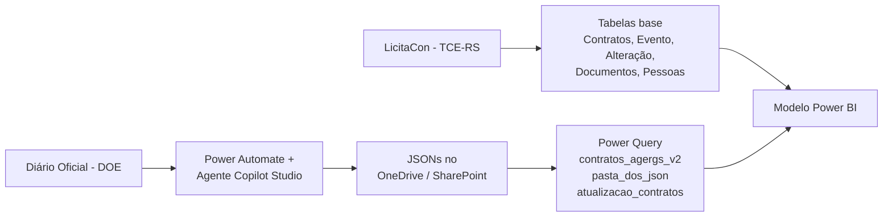

# 📑 Análise dos Contratos — AGERGS

Painel em **Power BI** desenvolvido na **AGERGS** (Agência Estadual de Regulação dos Serviços Públicos Delegados do Rio Grande do Sul) para acompanhar o **ciclo de vida dos contratos da agência**: assinatura, termos aditivos, prorrogações, renovações, ordens de início e publicações.

O painel junta duas fontes:
- **LicitaCon (TCE-RS)**: base oficial com contratos, eventos, alterações, documentos e fornecedores;
- **Diário Oficial do Estado (DOE)**: atualizações extraídas das publicações por um agente de IA. Assim o painel fica atualizado antes de os dados chegarem ao LicitaCon.

---

## 📌 Sumário

- [Contexto e problema](#-contexto-e-problema)
- [Visão geral do dashboard](#️-visão-geral-do-dashboard)
- [Funcionalidades](#️-funcionalidades)
- [Arquitetura da solução](#️-arquitetura-da-solução)
- [Modelo de dados](#️-modelo-de-dados)
- [Medidas DAX](#-medidas-dax)
- [Tratamentos no Power Query](#-tratamentos-no-power-query)
- [Tecnologias](#️-tecnologias)
- [Aprendizados](#-aprendizados)
- [Próximos passos](#-próximos-passos)

---

## 🎯 Contexto e problema

As informações sobre os contratos da AGERGS estavam espalhadas:
- os dados estruturados (valores, eventos, aditivos e documentos) ficam no **LicitaCon**, que não é atualizado em tempo real;
- as alterações mais recentes, como renovações, prorrogações e aditivos, saem primeiro no **Diário Oficial**;
- os responsáveis por cada contrato (**gestores e fiscais**) eram controlados à parte.

Para responder perguntas simples, como *"quanto esse contrato já cresceu desde a assinatura?"*, *"quem é o fiscal atual?"* ou *"onde está o PDF do 3º termo aditivo?"*, era preciso consultar vários sistemas e documentos.

O dashboard reúne tudo em uma tela, com histórico de eventos, evolução de valor, responsáveis e links para os documentos.

---

## 🖥️ Visão geral do dashboard

| Área | Descrição |
|---|---|
| **Cabeçalho** | Título, data da última atualização (*"Atualizado em dd/mm/aaaa"*) e botão **Início** |
| **Filtros** | Fornecedor, Gestor, Fiscal, Nº processo, Nº contrato, Tipo de evento, Tipo de operação, intervalo de datas e busca no objeto do contrato |
| **Tabela de eventos** | Histórico cronológico de todos os eventos dos contratos |
| **Evolução** | Gráfico de linha com o valor do contrato ao longo do tempo |
| **Evolução do contrato** | Cards de Valor inicial, Valor atual, Variação (R$) e Variação (%) |
| **Downloads** | Lista de arquivos do contrato com link direto para download |

---

## ⚙️ Funcionalidades

### 🔎 Filtros
- **Fornecedor, Nº processo, Nº contrato**: localizam o contrato direto.
- **Gestor e Fiscal**: mostram os contratos sob responsabilidade de cada servidor, a partir de tabelas normalizadas.
- **Tipo de evento**: Termo Aditivo, Ordem de Início, Publicação etc.
- **Tipo de operação**: Prorrogação de prazo, Renovação, Outras alterações etc.
- **Data do evento**: intervalo personalizado.
- **Pesquisa no objeto**: busca por texto na descrição do objeto do contrato.
- **Limpar filtros**: volta ao estado inicial. Há uma dica na tela sobre segurar **CTRL** para selecionar vários itens.

### 📋 Tabela de eventos
Colunas: **Data evento, Nº contrato, Tipo operação, Nº processo, Fornecedor, Tipo evento, Nº dias novo prazo, Acréscimo (R$), Acréscimo (%)**.

### 📈 Evolução do contrato
Ao **selecionar um processo** na tabela:
- o gráfico mostra a **linha do tempo do valor**, com rótulo de valor e variação acumulada (ex.: `R$ 69.800,00 → R$ 143.210,36 (+105,17%)`);
- os cards mostram **Valor inicial, Valor atual, Variação (R$) e Variação (%)**;
- a tabela de **Downloads** fica restrita aos documentos daquele contrato.

Sem seleção, o painel mostra *"Selecione um processo para visualizar sua evolução"* e os cards ficam com `--`.

### 📎 Downloads
Lista os arquivos do contrato (PDFs de termos aditivos, planilhas de custos etc.) com **link clicável** para baixar o documento original.

---

## 🏗️ Arquitetura da solução

### Fluxo do DOE

1. O **Power Automate** processa as publicações do Diário Oficial.
2. Um **agente no Copilot Studio** lê as publicações ligadas a contratos e extrai em **JSON** os dados de renovação ou aditivo: contrato, valor, vigência, link, gestor, fiscal e tipo.
3. Os JSONs são salvos em uma pasta no **OneDrive/SharePoint**.
4. O Power Query lê a pasta (`contratos_agergs_v2`), expande os arquivos e **mantém só o registro mais recente por `id_contrato`**.
5. O resultado (`atualizacao_contratos`) complementa os dados do LicitaCon.

---

## 🗂️ Modelo de dados

O modelo tem uma **tabela central de contratos**, uma **tabela de eventos** com o histórico e dimensões auxiliares. A chave principal de ligação é **`ID_CONTRATO_ANO`**, uma chave composta criada para identificar o contrato de forma única, já que o número do contrato se repete entre anos.

### Tabelas principais (LicitaCon)

| Tabela | Papel | Destaques |
|---|---|---|
| `Contratos` | Dimensão central | `ANO_CONTRATO`, `ANO_LICITACAO`, `ANO_PROCESSO`, `ANO_ASSINATURA` (calc.), `CD_TIPO_MODALIDADE`, `CNPJ_CONSORCIO`, `CNPJ_ORGAO_GERENCIADOR`, flags `BL_*`, `DIAS_RESTANTE_CONTRATO` (calc.) |
| `Evento` | Fato: histórico de eventos | `DT_EVENTO`, `CD_TIPO_EVENTO`, `DS_PUBLICACAO`, `NR_CONTRATO`, `NR_PROCESSO`, `NR_REGISTRO`, `SQ_EVENTO`, `ID_CONTRATO_ANO` |
| `Alteração` *(oculta)* | Detalhe das alterações | `CD_TIPO_OPERACAO`, `DS_JUSTIFICATIVA`, `DS_OUTRA_OPERACAO`, `NR_DIAS_NOVO_PRAZO`, `NR_DOCUMENTO_ANTERIOR/NOVO`, acréscimos |
| `Alteracao_Evento` | Junção alteração × evento, já tratada | `DT_EVENTO`, `SQ_EVENTO`, `TIPO_OPERACAO_DESC`, `DiasNovoPrazo`, `PcAcrescimo` |
| `Documentos` | Arquivos do contrato | `ARQUIVO_URL_DOWNLOAD`, `NOME_ARQUIVO_DOCUMENTO`, `CD_TIPO_DOCUMENTO`, `ARQUIVO_HASH_MD5`, `ID_EVENTO_CONTRATO` |
| `Pessoas` | Fornecedores | Endereço, `DS_EMAIL`, `DS_OBJETO_SOCIAL`, `DS_PAGINA_INTERNET` etc. |

### Tabelas de atualização (DOE)

| Tabela | Papel |
|---|---|
| `contratos_agergs_v2` *(oculta)* | Leitura da pasta de JSONs (Content, Folder Path, datas) |
| `pasta_dos_json` | JSONs expandidos: `contrato`, `fiscal`, `gestor`, `tipo`, `Name` |
| `atualizacao_contratos` | Última atualização por contrato: `id_contrato`, `valor`, `vigencia`, `link`, `nome` |
| `Atualizacao` | `DataAtualizacao`, usada no cabeçalho *"Atualizado em..."* |

### Responsáveis

| Tabela | Papel |
|---|---|
| `Gestores` / `Fiscais` | Responsável por contrato, com `Final Vigência` e indicação do responsável **atual** (`Gestor_Atual`, `Fiscal_Atual`) |
| `Gestores_Normalizados` / `Fiscais_Normalizados` | Uma linha por responsável × contrato, para alimentar os filtros sem nomes duplicados ou grafados de formas diferentes |

### Apoio

| Tabela | Papel |
|---|---|
| `Calendario` | `Data`, `Ano`, `AnoMes`, `Dia`, `Dia semana` |
| `Medidas` | Tabela só para organizar as medidas |

---

## 📐 Medidas DAX

| Medida | Uso |
|---|---|
| `Acréscimo (R$)` | Valor acrescido em cada evento |
| `% VL contrato` | Percentual do acréscimo sobre o valor do contrato |
| `Delta Válido (R$)` | Variação de valor considerada válida por evento |
| `Delta Válido Acumulado (R$)` | Soma acumulada das variações até a data, base do gráfico de evolução |
| `_Data Base Apostilamento` | Data de referência para apostilamentos e reajustes |
| `Contratos último ano` / `Contratos últimos 6 meses` | Contagem de contratos no período |
| `Descrição objeto` / `Descrição observação` | Textos dinâmicos do contrato selecionado |
|  `Valor inicial, Valor atual, Variação (R$), Variação (%)` | Cards de evolução |

---

## 🧹 Tratamentos no Power Query

| Tratamento | O que faz |
|---|---|
| Chave composta `ID_CONTRATO_ANO` | Une contrato e ano para ligar todas as tabelas |
| Leitura de pasta de JSONs | Lê e expande os arquivos do OneDrive/SharePoint |
| Deduplicação por data | Mantém só o JSON mais recente de cada `id_contrato` |
| Normalização de gestores e fiscais | Padroniza nomes e quebra listas em linhas |
| Decodificação de códigos | Converte `CD_TIPO_OPERACAO` e `CD_TIPO_EVENTO` em descrições legíveis |
| URLs clicáveis | Colunas de link marcadas como *URL da Web* |
| Organização do modelo | Colunas técnicas e tabelas intermediárias ocultas no relatório |

---

## 🛠️ Tecnologias

| Ferramenta | Uso |
|---|---|
| Power BI Desktop / Service | Relatório e publicação |
| Power Query (M) | ETL e tratamento dos dados |
| DAX | Medidas e cálculos de evolução |
| Power Automate | Processamento do DOE |
| Copilot Studio | Agente de extração de aditivos e renovações |
| OneDrive / SharePoint | Armazenamento dos JSONs |
| LicitaCon – TCE-RS | Fonte oficial dos contratos |

---

## 📚 Aprendizados

- Combinar uma **fonte oficial estruturada** (LicitaCon) com uma **fonte não estruturada** (texto do DOE) usando IA para extrair os dados.
- Criar **chaves compostas** quando a fonte não tem um identificador único confiável.
- Tratar relacionamentos **muitos-para-muitos** (gestores e fiscais) com tabelas normalizadas.
- Calcular **evolução acumulada de valor** e variação percentual por contrato.
- Montar uma tela de consulta em que um clique na tabela atualiza o gráfico, os cards e os downloads.

---

## 👤 Autor

**Antonio Augusto Geraldes Filho**
Estagiário de Dados/TI na AGERGS · Análise e Desenvolvimento de Sistemas, Senac-RS
📍 Porto Alegre, RS

> Os dados vêm de fontes públicas (LicitaCon/TCE-RS e Diário Oficial do Estado do RS).
