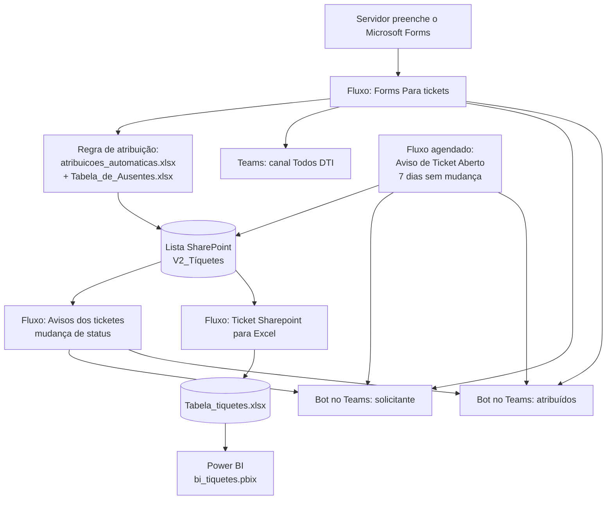
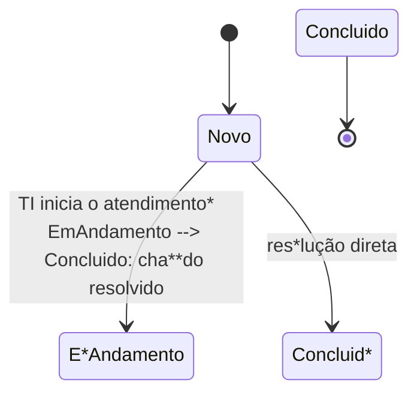
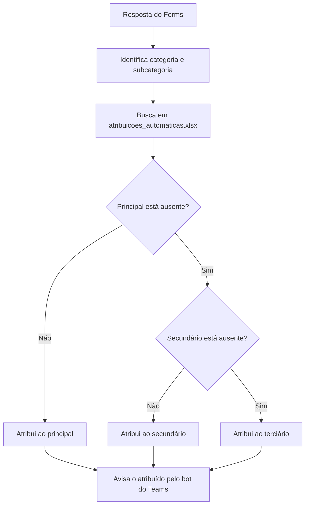
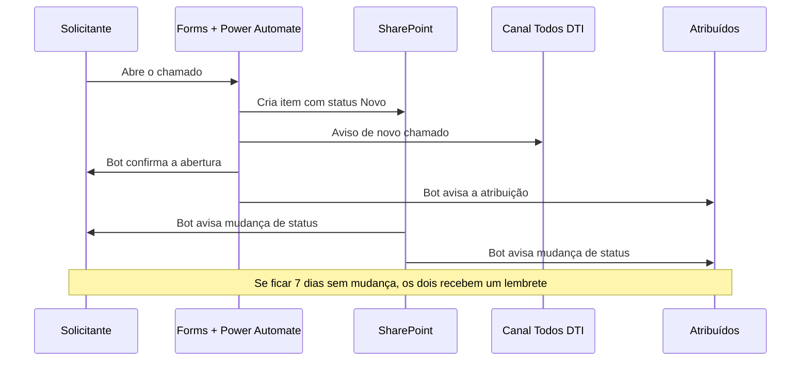

# 🎫 Sistema de Chamados da DTI — AGERGS

Solução de **automação de chamados (tickets)** desenvolvida na **AGERGS** (Agência Estadual de Regulação dos Serviços Públicos Delegados do Rio Grande do Sul) para a **Diretoria de TI (DTI)**.

O sistema cobre o ciclo completo de um chamado, só com ferramentas do Microsoft 365:
- o servidor abre o chamado pelo **Microsoft Forms**;
- o chamado vira um item em uma **lista do SharePoint**;
- o time de TI é **avisado no canal Todos DTI** do Teams;
- o chamado é **atribuído automaticamente** conforme o tipo de problema, respeitando quem está ausente;
- o solicitante e os atribuídos recebem **avisos de um bot no chat do Teams** a cada mudança de status;
- chamados parados há **7 dias** geram um lembrete automático;
- os dados vão para um **Excel** que alimenta um **painel no Power BI**.

---

## 📌 Sumário

- #-contexto-e-problema
- #-arquitetura-da-solução
- #-formulário-de-abertura
- #-lista-do-sharepoint
- #-fluxos-do-power-automate
- #-atribuição-automática
- #-notificações
- #-arquivos-de-apoio
- #-painel-no-power-bi
- #-tecnologias
- #-aprendizados
- #-próximos-passos

---

## 🎯 Contexto e problema

Antes da automação, os pedidos de suporte chegavam à DTI por canais diferentes, como e-mail, mensagem e pedidos pessoais. Isso causava:
- chamados perdidos ou sem dono;
- falta de histórico e de métricas de atendimento;
- quem abriu o chamado não sabia em que pé estava o pedido;
- distribuição manual das demandas, sem considerar quem estava de férias ou afastado.

A solução criou **uma porta de entrada única** (o Forms), **um registro central** (o SharePoint) e **comunicação automática** com a equipe e com os solicitantes.

---

## 🏗️ Arquitetura da solução

---

## 📝 Formulário de abertura

Formulário **"Registro de Chamado - DTI/AGERGS"** no Microsoft Forms, com **ramificação**: as perguntas mudam conforme o tipo de demanda escolhido.

| Nº | Pergunta | Tipo |
|---|---|---|
| 1 | Qual a sua Unidade na AGERGS? | Lista suspensa (obrigatória) |
| 2 | Qual o tipo de problema ou demanda? | Lista suspensa (obrigatória), define a ramificação |
| 3 | Qual o Problema, Falha ou Defeito? | Escolha única |
| 4 | Especifique o Acesso, Senha e Permissão necessário | Escolha única |
| 5 | Qual a solicitação e movimentação necessária? | Escolha única |
| 6 | Assessoria especializada | Escolha única |
| 7 | Qual o suporte necessário? | Escolha única |
| 8 | Descreva o problema ou demanda | Texto livre (obrigatória) |
| 9 | Qual a prioridade desta demanda ou problema? | Urgente / Importante / Média |
| 10 | Adicione evidências do problema | Upload (1 arquivo, até 10 MB) |

### Categorias e subcategorias

| Categoria | Opções |
|---|---|
| **Problema, falha ou defeito** | Computador, Notebook ou Periféricos · Sistemas ou Softwares (PROA, FPE, Office, PDF) · Impressora ou Scanner · Internet, Rede ou Telefonia |
| **Acesso, senha e permissão** | Novo Ingresso · Desligamento · Redefinição ou Desbloqueio de Senha · Alteração de Permissões ou Acessos Específicos · Liberação de Acesso Remoto (VPN/Túnel) · Alteração de Permissão ou Erro (SEI) |
| **Solicitação e movimentação** | Novo Equipamento ou Acessório · Troca de Equipamento com Defeito ou Obsoleto · Mudança de Computador para outra Mesa ou Setor · Solicitação e Troca de Toner |
| **Assessoria especializada** | Dados e Business Intelligence · Atualização ou Publicação no Site da AGERGS · Cancelamento de Documento no SEI · SIA, SINTRA, Aplicativo Móvel e DPA · Assunto não listado |
| **Suporte a reuniões e plenário** | Sessão do Conselho Superior (Plenário) · Reunião Híbrida ou Online · Empréstimo ou Ajuste de Equipamento Audiovisual |

---

## 📋 Lista do SharePoint

Os chamados ficam na lista **`V2_Tíquetes`**, no site **AGERGS - DTI-Chamados**.

| Coluna | Descrição |
|---|---|
| `ID` | Número sequencial do chamado |
| `Problema` / `Título` | Categoria e subcategoria vindas do Forms |
| `Unidade` | Unidade da AGERGS do solicitante |
| `Preenchido por` | Quem abriu o chamado |
| `Atribuído a` | Responsável definido pela atribuição automática |
| `Interessado` | Pessoas interessadas no chamado |
| `Descrição do problema` | Texto livre informado no formulário |
| `Prioridade` | Nível de prioridade do chamado |
| `Status` | **Novo**, **Em andamento** ou **Concluído** |
| `Evidência` | Arquivo anexado no formulário |
| `Criado` / `Modificado` | Datas de criação e da última alteração |

### Ciclo de status

> Cada mudança de status dispara um aviso para o solicitante e para os atribuídos.

### Exibições criadas

| Exibição | Uso |
|---|---|
| Caixa de Entrada | Chamados novos ou em aberto para a equipe |
| Minha Caixa de Entrada | Chamados atribuídos ao usuário logado |
| Status dos problemas | Chamados agrupados por status |
| Todos os Itens | Visão completa |

---

## ⚡ Fluxos do Power Automate

| Fluxo | Gatilho | O que faz |
|---|---|---|
| **Forms Para tickets** | Nova resposta no Forms | Lê a resposta, aplica a regra de atribuição, cria o item no SharePoint e envia os três avisos de abertura |
| **Avisos dos ticketes** | Item alterado no SharePoint | Detecta mudança de status e avisa o solicitante e os atribuídos pelo bot do Teams |
| **Aviso de Ticket Aberto** | Agendado | Procura chamados há 7 dias sem mudança de status e lembra o solicitante e os atribuídos |
| **Ticket Sharepoint para Excel** | Item criado ou alterado | Copia ou atualiza o chamado na `Tabela_tiquetes.xlsx`, base do Power BI |
| **Monitoramento de Tíquetes Todos** | Agendado | `[CONFIRMAR: o que este fluxo faz]` |

---

## 🤖 Atribuição automática

O responsável pelo chamado é definido sem intervenção manual. A planilha **`atribuicoes_automaticas.xlsx`** define, para cada tipo de problema, um responsável **principal**, um **secundário** e um **terciário**. Antes de atribuir, o fluxo consulta a **`Tabela_de_Ausentes.xlsx`**. Se a pessoa marcou que estará ausente, ela é pulada e o fluxo passa para a próxima da lista.

| Arquivo | Papel |
|---|---|
| `atribuicoes_automaticas.xlsx` | Define o principal, o secundário e o terciário de cada tipo de problema |
| `Tabela_de_Ausentes.xlsx` | A própria pessoa marca quando estará ausente, e a atribuição a ignora nesse período |

A vantagem de usar planilhas é que **a regra muda sem editar o fluxo**. Para trocar responsáveis ou registrar uma ausência, basta editar a planilha.

---

## 🔔 Notificações

| Evento | Quem recebe | Canal |
|---|---|---|
| Novo chamado aberto | Time de TI | Canal **Todos DTI** no Teams |
| Novo chamado aberto | Solicitante | Chat do bot com a pessoa no Teams |
| Novo chamado aberto | Pessoas atribuídas | Chat do bot com cada pessoa no Teams |
| Mudança de status | Solicitante e atribuídos | Chat do bot no Teams |
| 7 dias sem mudança de status | Solicitante e atribuídos | Chat do bot no Teams |

---

## 📁 Arquivos de apoio

| Arquivo | Função |
|---|---|
| `atribuicoes_automaticas.xlsx` | Regras de atribuição com principal, secundário e terciário |
| `Tabela_de_Ausentes.xlsx` | Registro de ausências da equipe |
| `Tabela_tiquetes.xlsx` | Base histórica dos chamados para análise |
| `bi_tiquetes.pbix` | Painel Power BI de acompanhamento dos chamados |

---

## 📊 Painel no Power BI

./img/bi-tiquetes.png

O `bi_tiquetes.pbix` usa a `Tabela_tiquetes.xlsx` como fonte, carregada em uma única tabela (`Consulta1`).

### Filtros

| Filtro | Uso |
|---|---|
| Unidade | Chamados de uma unidade da AGERGS |
| Atribuído a | Chamados de um responsável da TI |
| Interessado | Chamados em que a pessoa é interessada |
| Preenchido por | Chamados abertos por um solicitante |
| Prioridade | Filtra por nível de prioridade |
| Título | Filtra por tipo de problema |
| Limpar Filtro | Volta ao estado inicial |

### Indicadores

| Card | O que mostra |
|---|---|
| Tíquetes em Aberto | Chamados ainda não concluídos |
| Tíquetes Concluídos | Chamados com status Concluído |
| Total Tíquetes | Total de chamados registrados |
| Solicitantes | Número de pessoas diferentes que abriram chamados |
| Tíquetes Críticos | Chamados com prioridade crítica |

### Visuais

| Visual | O que mostra |
|---|---|
| Total Tíquetes por Unidade | Gráfico de barras com o volume de chamados por unidade |
| Tabela de chamados | Prioridade, Unidade, Atribuído a, Status, Data Criação e Descrição do problema |

### Modelo

Tabela única `Consulta1`, com colunas como `Ativo`, `Atribuído a`, `Caminho`, `Criado`, `Data Criação`, `Descrição do problema`, `Evidência`, `Interessado`, `Modificado`, `Prioridade`, `Status` e `Unidade`.

> Os níveis de prioridade no painel são Crítico, Alta e Normal. `[CONFIRMAR: como eles se relacionam com Urgente, Importante e Média do formulário]`

---

## 🛠️ Tecnologias

| Ferramenta | Uso |
|---|---|
| Microsoft Forms | Porta de entrada dos chamados, com ramificação |
| SharePoint Online | Lista `V2_Tíquetes` como registro central |
| Power Automate | Fluxos automatizados e agendados |
| Microsoft Teams | Canal Todos DTI e bot de avisos individuais |
| Excel (OneDrive/SharePoint) | Regras de atribuição, ausências e base histórica |
| Power BI | Painel de acompanhamento |

---

## 📚 Aprendizados

- Modelar um **processo de atendimento completo** só com ferramentas do Microsoft 365, sem sistema de chamados pago.
- Usar **ramificação no Forms** para deixar o formulário curto e preciso.
- Separar a **regra de negócio (planilhas)** da **lógica (fluxos)**, para facilitar a manutenção.
- Fazer a **atribuição com fallback** (principal, secundário e terciário), levando em conta as ausências da equipe.
- Combinar fluxos **por evento** com fluxos **agendados**, como o lembrete de 7 dias.
- Enviar **avisos individuais por bot** no Teams, sem lotar o canal da equipe.
- Criar uma **base histórica** separada do SharePoint para análises no Power BI.

---

## 🚀 Próximos passos

- [ ] Pesquisa de satisfação automática ao concluir o chamado
- [ ] Indicadores de tempo de atendimento e SLA por prioridade no Power BI
- [ ] Base de conhecimento ligada às Perguntas Frequentes do site

---

## 👤 Autor

**Antonio Augusto Geraldes Filho**
Estagiário de Dados/TI na AGERGS · Análise e Desenvolvimento de Sistemas, Senac-RS
📍 Porto Alegre, RS

> Nomes de servidores e dados pessoais foram omitidos das imagens deste repositório.
